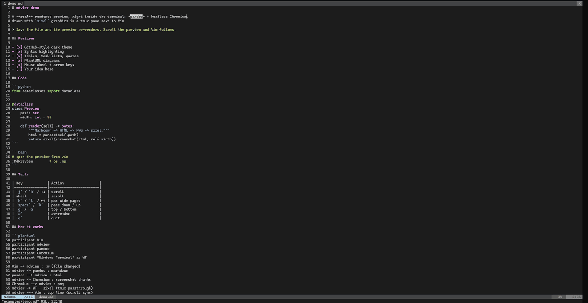
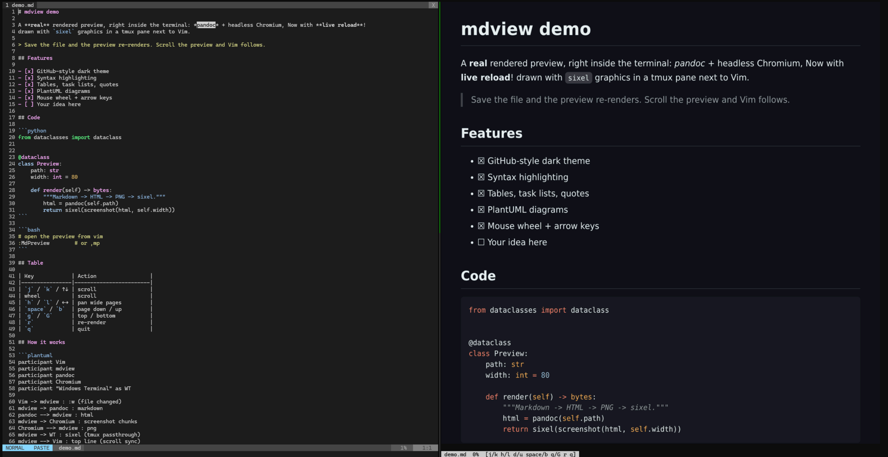
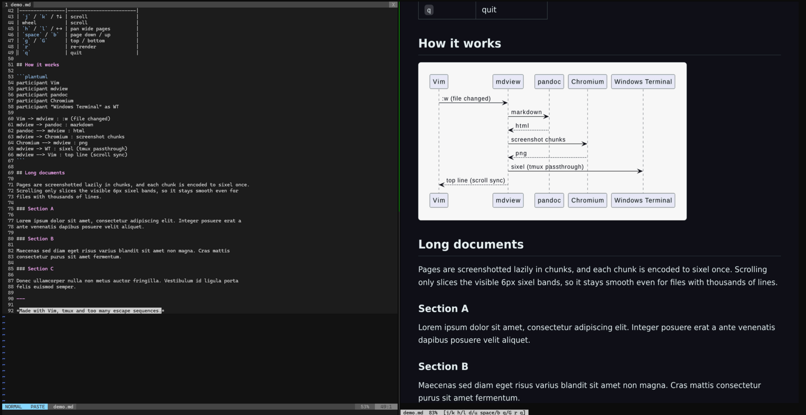

# vim-wsl-markdown-preview

A real, rendered Markdown preview **inside the terminal**, next to Vim, on WSL —
no browser window. Markdown is rendered by pandoc + headless Chromium and drawn
as an image with **sixel** graphics in a tmux pane.



## Features

- GitHub-style dark theme, syntax highlighting, tables, task lists, quotes
- **PlantUML** diagrams (```` ```plantuml ```` blocks)
- Live reload on `:w`, with a loading animation
- Smooth scrolling: mouse wheel, arrow keys, `j/k`, page up/down
- **Scroll sync**: scrolling the preview scrolls Vim to roughly the same place
- Long files: pages are rendered lazily in chunks, so thousands of lines are fine
- Reflows to the pane width on resize; `←/→` pans pages wider than the pane
- Survives tmux window switches and zoom (redraws from cache instantly)





## Requirements

- WSL with **Windows Terminal 1.22+** (sixel support)
- **tmux 3.4+** (the preview runs in a tmux pane)
- Vim 8.2+/9 with `+terminal +timers`
- `pandoc`, ImageMagick 7 (`magick`), `img2sixel` (libsixel), `python3`
- a headless Chromium: Playwright's `chrome-headless-shell`
  (`npx playwright install chromium-headless-shell`), or `chromium`/`google-chrome` on PATH
- optional: `java` for PlantUML

```sh
sudo apt install pandoc imagemagick libsixel-bin python3 tmux default-jre-headless
```

## Install

```sh
git clone https://github.com/CNuhlar/vim-wsl-markdown-preview
cd vim-wsl-markdown-preview
./install.sh
```

This installs `~/.local/bin/mdview`, its assets in `~/.local/share/mdview`
(and downloads `plantuml.jar` there), and `~/.vim/plugin/mdpreview.vim`.

## Usage

In Vim, on a Markdown file inside tmux:

```
:MdPreview      or  ,mp   (<leader>mp)
```

toggles the preview pane on the right. Outside tmux it falls back to
[glow](https://github.com/charmbracelet/glow) in a Vim terminal split.

`mdview file.md` also works standalone.

| Key                  | Action                 |
|----------------------|------------------------|
| `j`/`k`, `↑`/`↓`, wheel | scroll              |
| `h`/`l`, `←`/`→`     | pan pages wider than the pane |
| `d`/`u`              | half page down / up    |
| `space`/`b`, PgDn/PgUp | page down / up       |
| `g`/`G`              | top / bottom           |
| `r`                  | re-render              |
| `q`                  | quit                   |

## How it works

1. `pandoc -f gfm+sourcepos` turns Markdown into HTML (a Lua filter renders
   PlantUML blocks to inline SVG, cached by content hash).
2. Headless Chromium measures the page and screenshots it lazily in 4000px chunks.
3. Each chunk is scaled to the pane width and encoded to sixel **once**, then split
   into 6px sixel bands. Scrolling just slices the visible bands — no re-encoding.
4. tmux doesn't forward sixel itself, so the image goes through tmux passthrough
   (`allow-passthrough` is enabled for the preview pane only), positioned at the
   pane's absolute screen coordinates.
5. pandoc's source positions give a "y → source line" map; the top visible line is
   written to a file that the Vim plugin polls to scroll the editor.
6. tmux hooks signal mdview when its window comes back on screen, so the cached
   image is re-sent right away.

## Configuration

| Env var        | Default | Meaning |
|----------------|---------|---------|
| `MDVIEW_CELL`  | `10x20` | terminal cell size in sixel pixels (Windows Terminal maps sixel onto a 10x20 virtual cell) |
| `MDVIEW_CHROME`| auto    | path to a headless Chrome binary |

The look is plain CSS: `~/.local/share/mdview/style.css`.
